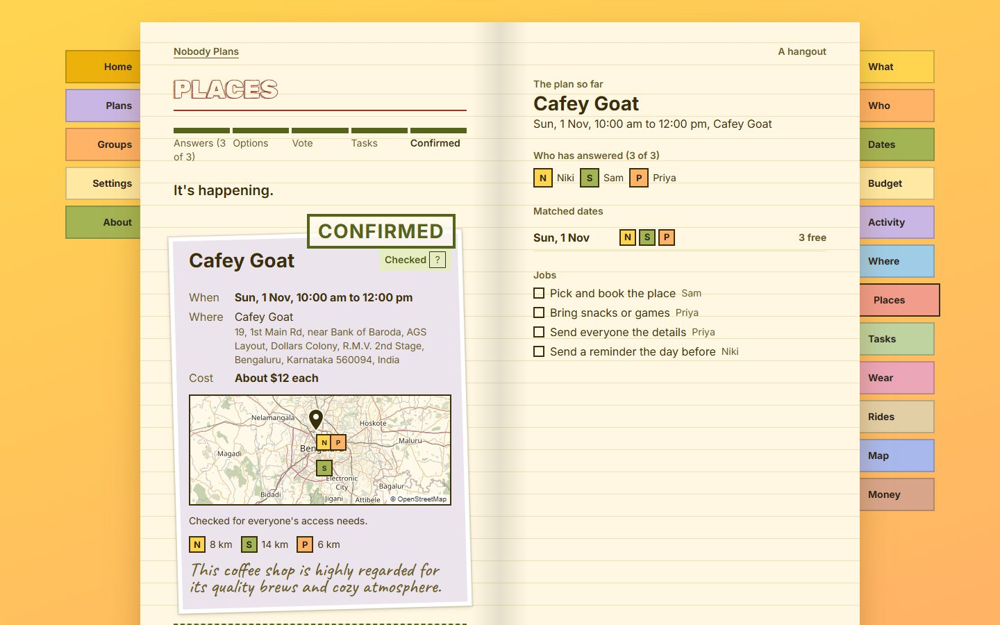
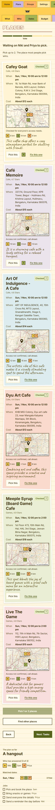
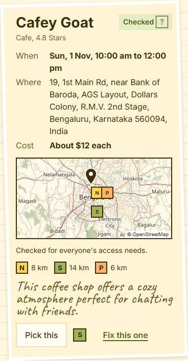
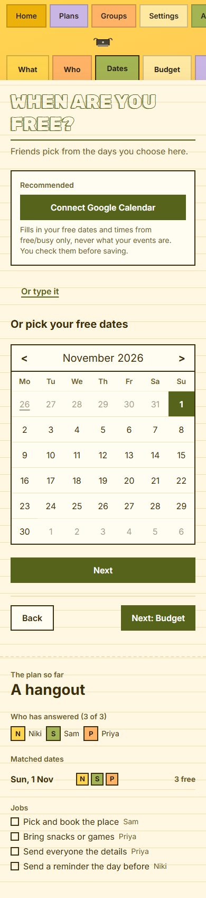
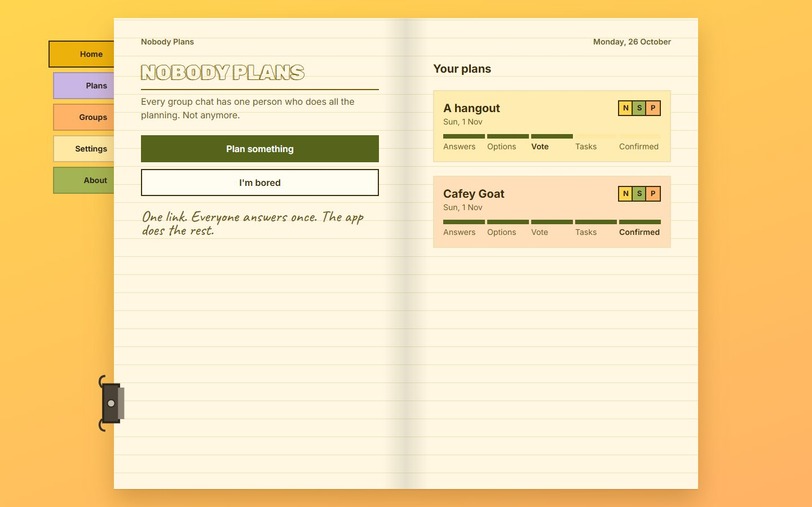
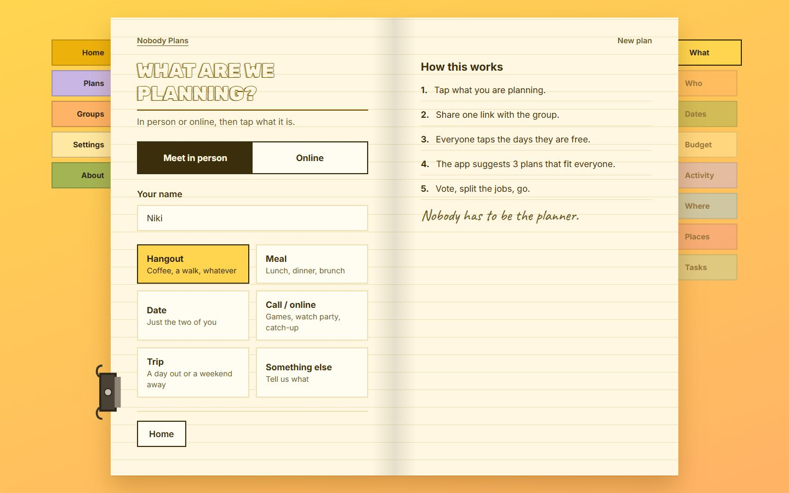
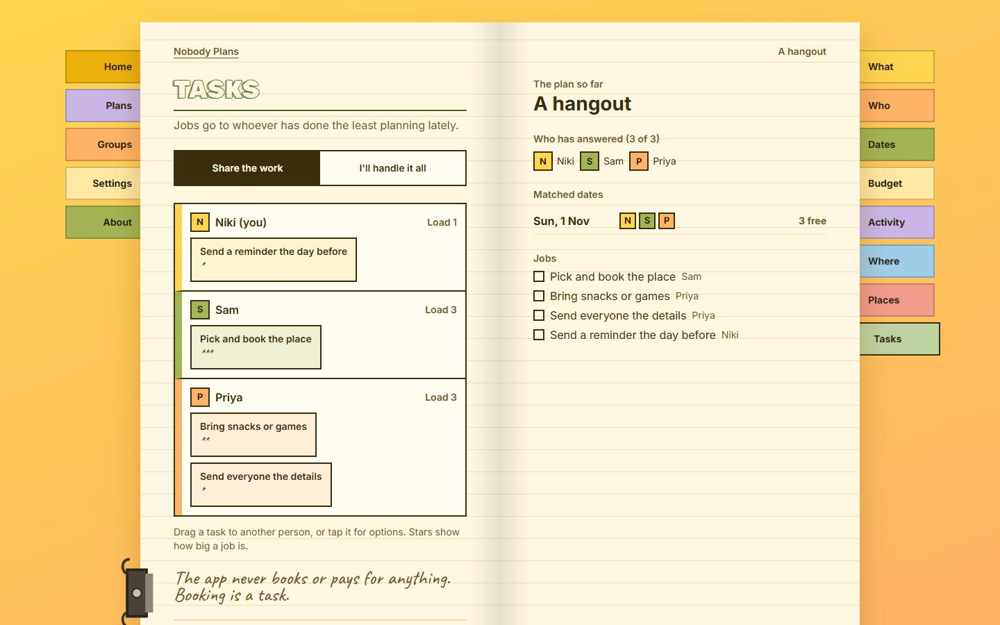

<div align="center">

# Nobody Plans

**Every group chat has one person who does all the planning.<br>This app does it so nobody has to be that person.**


*Built for the DEV Hacktoberfest Open-Source AI Challenge, Week 3: "Slow and Steady".*

</div>

---

**Live:** https://nobody-plans.onrender.com



## Screenshots

All taken on the live site with real places from Google Maps (via SerpApi), ranked by Gemma 4 and checked by code.

| Real places to pick from | The map: meeting pin, everyone's rough area | When are you free? |
|---|---|---|
|  |  |  |

| Home | What are we planning? | Jobs split fairly |
|---|---|---|
|  |  |  |

Every screen, on phone and laptop, is in [`docs/screenshots`](docs/screenshots).

## The problem

Planning one dinner takes dozens of messages over days. Someone asks when everyone is free, chases replies,
finds a place, checks it fits everyone's budget, splits the jobs and sends reminders. If that person stops,
nothing happens.

When2meet does times. Splitwise does money. Google Maps does places. Nobody takes over the whole job.

## How it works

| Step | What happens | Who does it |
|---|---|---|
| 1. Start | One person starts a plan and shares one link | You (30 seconds) |
| 2. Answer | Everyone answers once: free times, city, budget, vibe | Each member (under 60 seconds) |
| 3. Find times | Availability is intersected across time zones, no 3 AM calls | Code |
| 4. Suggest | 3 plans from real nearby places and events | Gemma + SerpApi |
| 5. Check | Every plan is checked for time, budget, distance and real places | Code |
| 6. Vote | "I'm in" / "Maybe" / "Can't", majority locks it | Everyone |
| 7. Split jobs | Tasks go to whoever has done the least planning lately | Code |
| 8. Remind | Calendar invite and reminders, so nobody chases anyone | The app |

And the hero button: **"I'm bored."** It finds who is free soon, finds something that fits, and sends the group a one-tap vote.

## Gemma suggests, code checks

The model never has the final word on times, budgets or distances. Every plan card passes a plan checker before anyone sees it:

- The time is inside a window where everyone is free
- The cost per person is at or below the **lowest** budget in the group
- Every member is within their max travel distance
- The place or event actually came from SerpApi results (no invented places)

A failed card gets one retry with the failure named. If it fails again, it is dropped and logged to Sentry.

## Why open source

- **Privacy:** it handles calendars, locations and budgets. Gemma runs on our own server or a laptop.
- **Cost:** no per-suggestion bill means no ads or subscription for friend groups.
- **Control:** the checker and fairness rules are ours, and the model is one env var away from being swapped.

## Tech stack

| Layer | Choice |
|---|---|
| Frontend | React, Vite, TypeScript, Tailwind (mobile-first) |
| Backend | FastAPI (Python 3.12) |
| LLM | Gemma 4 through one OpenAI-compatible client: Ollama locally, DigitalOcean when hosted |
| Places and events | SerpApi (Google Maps local results, Google Events) |
| Data | MongoDB Atlas (JSON files on disk for local dev) |
| Observability | Sentry tracing on every Gemma and SerpApi call |
| Hosting | Render, one Docker service from `render.yaml` |

## Run it locally

```bash
# backend
py -3.12 -m venv .venv
.venv/Scripts/pip install -r backend/requirements.txt   # macOS/Linux: .venv/bin/pip
cp .env.example .env
cd backend && ../.venv/Scripts/uvicorn app.main:app --reload

# frontend (second terminal)
cd frontend && npm install && npm run dev
```

Open http://localhost:5173. With no keys set, it uses local Ollama Gemma and stores data in `data/local_store`.

## Status

Under active development for the hackathon. See [`NOTES.md`](NOTES.md) for the build log and [`PRD-week3.md`](PRD-week3.md) for the full plan.

## License

MIT
